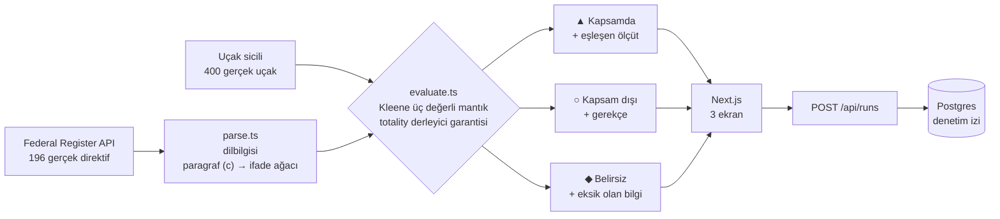
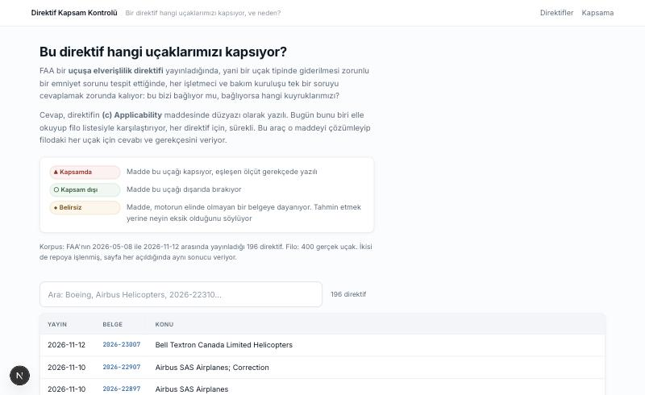
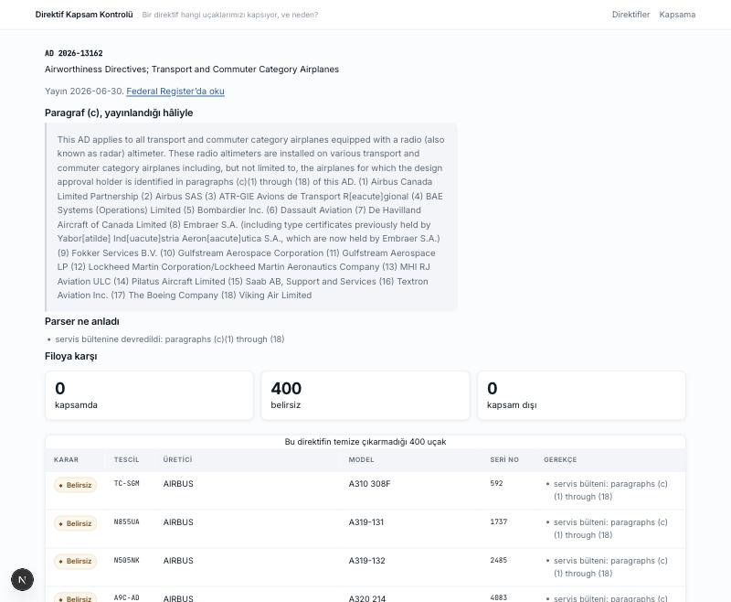
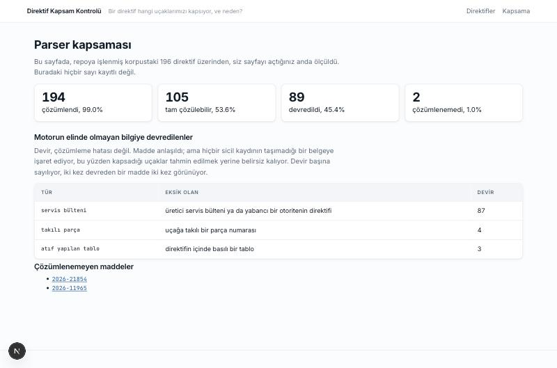

# Direktif Kapsam Kontrolü

**Bir uçakta zorunlu bir arıza giderme emri yayınlandığında, filodaki hangi uçakları bağladığını söyler, ve her uçak için neden o kararı verdiğini gösterir.**

Karar veremediğinde tahmin etmez: hangi bilginin eksik olduğunu söyler. Gerçek direktifler, gerçek uçaklar, ölçülmüş kapsama.



## Neyi gösteriyor

| Yapılan iş | Kanıtı |
|---|---|
| **Regülasyon metnini çalıştırılabilir kurala çevirme.** Paragraf (c) düzyazı; ondan bir ifade ağacı çıkaran dilbilgisi elle yazıldı | 196 gerçek maddenin **%99'u** çözümleniyor, `npm test` ölçüyor, [`docs/coverage.md`](docs/coverage.md) yazıyor |
| **Üç değerli mantık.** Belirsizlik kenarda ele alınan bir hata değil, ifadenin içinde birleşen bir değer | Bilinmeyen bir olgu kesin bir kararı asla çeviremiyor: property testi. `conjoin`'i bozunca test düşüyor, bilerek doğrulandı |
| **Derleyici garantili totality.** Her uçak üç karardan tam birini alıyor | Düğüm tipi üzerindeki switch `never` ataması ile bitiyor; yeni bir tip ekleyip işlememek `tsc`'yi düşürüyor |
| **Kuralların şemada yaşadığı veritabanı** | `definite_verdict_has_reasoning` ve `undetermined_names_what_is_missing`: açıklanamayan bir kararı kaydetmek **imkânsız** |
| **Ajan yazdığı kodun denetimi** | Gözden geçirmenin yakaladığı **5 gerçek kusur**, nasıl bulundukları ile birlikte aşağıda yazılı |

**Sayılar:** 196 direktif × 400 uçak = **77.600 karar**. Bunların %0,6'sı belirsiz, oysa direktiflerin %45'i bir belgeye devrediyor. Farkı kapatan şey Kleene kısa devresi: kesin bir ret, yanındaki bilinmeyene rağmen sonucu belirliyor.

**Çalıştırmak:** `npm install && npm test`, başka hiçbir şey gerekmiyor. Arayüz için `npm run dev`, denetim kaydı için `docker compose up -d`.

## Ekranlar

Açılış ekranı: problem, üç karar türü ve korpus.



Bir direktif, filoya karşı. Her satırda karar ve gerekçesi:


Direktif kendi kapsamını söylemiyorsa motor tahmin etmiyor, neyin eksik olduğunu söylüyor:



Kapsama, her sayfa yüklemesinde korpustan yeniden ölçülüyor:



## Ne yapıyor

Paragraf (c)'yi bir ifade ağacına çeviriyor, filoya karşı değerlendiriyor ve her uçak için gerekçesiyle birlikte üç karardan birini döndürüyor:

| Karar | Anlamı |
|---|---|
| **kapsamda** (applies) | Madde bu uçağı kapsıyor, ve eşleşen ölçüt şu |
| **kapsam dışı** (does not apply) | Madde bu uçağı dışarıda bırakıyor, sebebi şu |
| **belirsiz** (undetermined) | Madde, motorun elinde olmayan bir bilgiye dayanıyor; o bilgi adıyla söyleniyor |

## "Belirsiz" neden ürünün kalbi

`data/corpus/ads.json` içindeki korpus üzerinde ölçüldü: **gerçek direktiflerin %45'i kendi kapsamını söylemiyor.** Kapsamı bir üretici servis bültenine, takılı bir parça numarasına ya da başka bir otoritenin direktifine devrediyor, hiçbiri halka açık olmayan, hiçbir sicil kaydının taşımadığı belgeler.

Orada tahmin eden bir motor işe yaramaz; bilinmeyeni "kapsam dışı" sayan bir motor ise tehlikelidir. Bu yüzden belirsizlik, ifadenin tamamı boyunca birleşen birinci sınıf bir değer, Kleene'in güçlü üç değerli mantığı. Önemli olan özellik şu: **bilinmeyen bir olgu cevabı yalnızca belirsize genişletebilir; kesin bir evet'i kesin bir hayır'a asla çeviremez.** Bu bir yorum değil, bir property testi (aşağıda).

Aynı mantıktan işe yarar bir sonuç da çıkıyor: kesin bir ret, yanındaki bilinmeyene rağmen konjonksiyonu tek başına sonuçlandırıyor. Yanlış modeldeki bir uçak, çözülemeyen parça koşulu ne derse desin kapsam dışıdır. Motorun korpusu, tam parse edilebilen madde oranından daha fazla çözmesinin sebebi bu.

## Kapsama, ölçülmüş

`npm test` tarafından, Mayıs–Kasım 2026 arasında yayınlanmış 196 gerçek direktiften üretiliyor. Güncel değerler: [`docs/coverage.md`](docs/coverage.md)

```
corpus                 196 directives
parsed                 194 (99.0%)
fully resolvable       105 (53.6%)
deferred to a document  89   (87 servis bülteni, 4 takılı parça, 3 tablo)
unparsed                 2
```

Motorun 194 parse edilmiş direktifi 400 uçaklık filoya karşı değerlendirmesi,
toplam 77.600 karar:

```
kapsamda       111   (%0,14)
kapsam dışı  77.027  (%99,3)
belirsiz        462   (%0,6)
```

Yukarıdaki kısa devre iddiası bu rakamla doğrulanıyor: direktiflerin **%45'i**
bir belgeye devrediyor, ama kararların yalnızca **%0,6'sı** belirsiz kalıyor,
çünkü kesin bir ret konjonksiyonu tek başına sonuçlandırıyor. Bu da bir test,
varsayım değil.

`tests/coverage.test.ts` içindeki eşikler bir kilit dişlisi: dilbilgisinde yapılan ve gerçek direktiflerin daha azını anlayan bir değişiklik, sessizce geçmek yerine testi düşürüyor.

## Veri nerede durur

İki tür veri var ve ikisi farklı yere ait:

**Referans verisi dosyada.** Korpus ve filo anlık görüntüsü salt okunur, ve
yukarıdaki her kapsama değeri çevrimdışı tekrar üretilebilmek zorunda. Barındırılan
bir veritabanı bunu garanti etmiyor, commit'lenmiş dosya ediyor. 400 uçak ve 196
direktif de bir veritabanının yerini hak ettiği eşiğin altında.

**Kararlar Postgres'te.** Bir değerlendirme sonucu, birinin sonradan savunmak
zorunda olduğu bir kayıt: *bu direktif hakkında hangi tarihte ne karar verdik,
hangi parser sürümüyle, o anda hangi uçaklar belirsizdi.* Denetimin sorduğu soru
bu, ve `assessment_run.parser_version` o yüzden var.

Kısıtlar uygulama kodunda değil şemada: `definite_verdict_has_reasoning` ve
`undetermined_names_what_is_missing`, **açıklanamayan bir kararın kaydedilmesini
imkânsız** kılıyor. Uygulama eninde sonunda bir doğrulamayı atlayan bir yol
içerir, veritabanı içermez.

```
docker compose up -d      # şema migrations/ içinden uygulanır
npm test                  # veritabanı kapalıysa 4 test atlanır, paket yeşil kalır
```

## Neyi yapmıyor

Açıkça yazılıyor, çünkü bu sınır bir tasarım kararı, yapılacaklar listesi değil:

- **Uyum süresi hesabı yok.** Direktifler son tarihleri uçuş saati, çevrim ya da takvim ayı cinsinden, bir başlangıç olayına göre veriyor. Kullanım verisi halka açık değil, o yüzden motor son tarih hesaplıyormuş gibi yapmıyor.
- **Servis bülteni kütüphanesi yok.** Üretici bültenleri halka açık değil. %45'lik devir oranının sebebi bu ve açık veriyle çözülebilir bir şey değil.
- **Modifikasyon durumu yok.** Sicil kaydı bir uçağa hangi bültenlerin uygulandığını tutmuyor, o yüzden "şu bülten uygulanmış olanlar hariç" ifadesi yapısal olarak belirsize çözülüyor.
- **Seri numarası karşılaştırması bilinçli olarak kısmi.** Sıralama yalnızca aynı tanınan biçimdeki seriler arasında tanımlı; gerisi tahmin yerine belirsiz döndürüyor. Karşılaştırmayı reddetmek bir özellik.
- **Filo verisi dünya çapında, ABD tescilli değil.** Gerekçesi `scripts/fetch-fleet.py` başında yazılı: FAA'nın kendi sicil veritabanı otomatik isteklere 403 ve 503 dönüyor, o yüzden programatik erişim için yayınlanan OpenSky uçak veritabanı kullanıldı. İçindeki her uçak gerçek bir uçak, her seri numarası gerçek bir seri numarası; ama bir FAA direktifinin gerçekten bağladığı popülasyon değil.

## Arayüz

Next.js (App Router) ile aynı repoda, üç ekran:

- **`/`** yayın tarihine göre direktif listesi, belge numarası / üretici / başlık araması
- **`/directives/<belge-no>`** maddenin kendi metni, parser'ın anladıkları, ve uçak
  başına karar: kapsamda ve belirsiz olanlar önde, kapsam dışı olanlar kapalı bir
  bölümde, çünkü kimse onlara göre işlem yapmıyor. Karar rengi tek sinyal değil:
  her kararın bir sözcüğü ve bir şekli de var.
- **`/coverage`** yukarıdaki kapsama tablosu, sayfa her açıldığında korpustan
  yeniden ölçülerek

Veri yükleme sunucu bileşenlerinde; istemci bileşeni yalnızca arama kutusunda ve
"Bu değerlendirmeyi kaydet" düğmesinde var. O düğme `POST /api/runs` ile
`recordRun()`'ı çağırıyor; Postgres kapalıyken sayfa çökmüyor, 503 ve ne
yapılacağını söyleyen bir mesaj dönüyor.

## Çalıştırma

```
npm install
npm test          # test paketi + docs/coverage.md üretir
npm run typecheck
npm run dev       # arayüz, http://localhost:3000
npm run build
```

Korpusu Federal Register'dan yenilemek için:

```
python3 scripts/fetch-corpus.py
python3 scripts/fetch-fleet.py
```

Korpus bilerek repoya işlenmiş. Yukarıdaki her kapsama değerinin çevrimdışı tekrar üretilebilmesi gerekiyor, ve parser'ın ölçüldüğü metnin parser'ı iyi göstermek için seçilmiş örnekler değil düzenleyicinin kendi ifadesi olması gerekiyor.

## Bu nasıl yazıldı

Kodlama ajanlarıyla (Claude Code) yazıldı; kimsenin bir konvansiyonu hatırlamasına bağlı olmayan kapılar altında. Gözden geçirmenin gerçekten yakaladığı üç kusur, çünkü iddia, kanıt olmadan hiçbir şey ifade etmiyor:

1. **Bir ASCII tabloyu yutup uçak modeli diye raporlayan parser.** AD 2026-22785 şöyle başlıyor: *"Lycoming Engines (Lycoming) Model engines identified in table 1 ..."*, burada `Model`'den sonraki kelime kategori kelimesinin kendisi. Lazy bir eşleşme sıfır uzunlukta duramaz, o yüzden metinde çok ileride başka bir "engines" geçişine kadar koştu ve arada bir tablo çizgisini yakaladı. Çökme değil, ret değil: **kendinden emin yanlış cevap**, yani hiçbir tip denetleyicisinin göremediği sınıf. 196 maddenin tamamı üzerinde çalışan bir property testi buldu (hiçbir model tanımı kategori kelimesi içeremez); tam birinde düştü. Zaten okuduğum örneklerden yazılmış bir test geçerdi.
2. **Alternatif model grupları AND'lenmişti.** Kendi alt paragraflarına atıf yapan direktifler tek maddede birkaç model dizisi üretiyor. Bunları AND'lemek, hiçbir uçak aynı anda A330-243 ve A330-941 olamayacağı için o şekildeki her direktifi **tüm filo için "kapsam dışı"** diye çözüyordu: temiz, kendinden emin, evrensel bir yanlış negatif.
3. **Negasyon birleştiricisinde iki dalı da boş dizi olan bir koşul.** Tip denetiminden geçti, var olan testlerden de geçti, ve her dışlamanın gerekçesini sessizce düşürdü. Diff okunurken yakalandı, test bulmadı, ve asıl bulgu o boşluk: hiçbir test bir reddin *gerekçe içeriğine* bakmıyordu, yalnızca karar tipine bakıyordu.

4. **Üretici kısıtının düşürülmesi.** `Model engines` ifadesinde gerçek bir model
   tanımı yok, ve parser model bulamayınca üreticiyi de bırakıyordu, madde
   yalnızca devir düğümlerine indirgeniyordu. Sonuç: Lycoming motorlarıyla
   ilgili bir direktif, filodaki 400 uçağın hepsi için "belirsiz" dönüyordu,
   oysa hiçbiri Lycoming motoru değil. **Yalnızca motoru uçtan uca gerçek
   veride çalıştırmak ortaya çıkardı**; birim testleri de, parser testleri de
   geçiyordu, çünkü hiçbiri parse sonucunu bir filoya karşı değerlendirmiyordu.
   Düzeltme yeni bir AST düğümü gerektirdi, ve derleyici onu değerlendiricide
   ele almaya zorladı, totality garantisinin işe yaradığı yer burası.

5. **Sessizce atlayan veritabanı testleri.** `describe.skipIf` toplama anında
   değerlendiriliyor, oysa bayrak `beforeAll` içinde kuruluyordu, yani bayrak o
   anda hep `false` ve dört test, veritabanı ayakta olmasına rağmen her koşumda
   sessizce atlanıyordu. Paket yeşil görünüyor, hiçbir şey doğrulamıyordu.
   Sessizce atlayan bir test, düşen testten kötüdür. Erişilebilirlik kontrolü
   artık modül kapsamında, top-level await ile. İki dal da elle doğrulandı:
   veritabanı kapalı 22 geçer/4 atlanır, açık 26 geçer.

Talimatla değil mekanik olarak zorlananlar:

- **Totality** derleme zamanı garantisi. Düğüm tipi üzerindeki switch bir `never` ataması ile bitiyor, yani yeni bir düğüm tipi ekleyip işlememek `tsc`'yi düşürüyor.
- **Monotonluk** bir property testi. `conjoin`'i belirsizi ret sayacak şekilde geri almak onu düşürüyor, varsayılmadı, bilerek doğrulandı.
- **Kapsama** bir kilit dişlisi, yukarıda anlatıldığı gibi.

## Lisans

MIT
