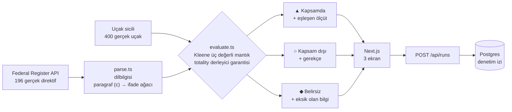
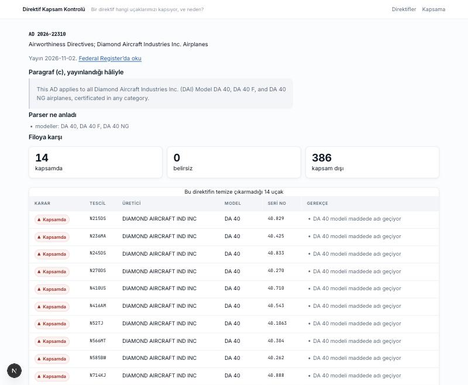

# Direktif Kapsam Kontrolü

**Bir uçakta zorunlu bir arıza giderme emri yayınlandığında, maddenin filodaki hangi uçaklarla eşleştiğini söyler, ve her uçak için neden o kararı verdiğini gösterir.**

Karar veremediğinde tahmin etmez: hangi bilginin eksik olduğunu söyler. Gerçek direktifler, gerçek uçaklar, ölçülmüş kapsama.

## Bu ne işe yarıyor

Bir uçak tipinde emniyeti etkileyen bir sorun bulunduğunda (bir parçada çatlak riski, bir sistemde arıza), havacılık otoritesi **zorunlu bir talimat** yayınlıyor: şu uçaklarda şu işlem şu tarihe kadar yapılacak. Buna *uçuşa elverişlilik direktifi* deniyor ve uyum zorunlu; şartları yerine getirilmeden uçağın uçuşa elverişliliği etkileniyor.

Sorun şurada: talimat kimleri bağladığını bir liste olarak değil, **düzyazı bir paragraf** olarak yazıyor. *"Şu üreticinin şu modelleri, şu seri numaraları arasında, şu bülten uygulanmış olanlar hariç."* Bir havayolunun yüzlerce uçağı var ve yılda yüzlerce direktif yayınlanıyor. Bu araç, o paragrafı filoya karşı değerlendirme adımını hedefliyor; uyum sürecinin bakım kayıtları, modifikasyon geçmişi ve mühendislik değerlendirmesi gibi diğer adımlarını kapsamıyor.

Bu araç o paragrafı okuyup filodaki her uçak için cevabı veriyor. Emin olamadığında tahmin etmiyor: paragrafın dayandığı belge elinde yoksa bunu açıkça söylüyor.



## Neyi gösteriyor

| Yapılan iş | Kanıtı |
|---|---|
| **Regülasyon metnini çalıştırılabilir kurala çevirme.** Paragraf (c) düzyazı; ondan bir ifade ağacı çıkaran dilbilgisi elle yazıldı | Çözümlenebilirlik **%99** (194/196), elle denetlenen örneklemde doğruluk **18/20**. İkisi farklı şey, aşağıda ayrı ayrı |
| **Üç değerli mantık.** Belirsizlik kenarda ele alınan bir hata değil, ifadenin içinde birleşen bir değer | Bilinmeyen bir olgu kesin bir kararı asla çeviremiyor: property testi. `conjoin`'i bozunca test düşüyor, bilerek doğrulandı |
| **Derleyici garantili totality.** Her uçak üç karardan tam birini alıyor | Düğüm tipi üzerindeki switch `never` ataması ile bitiyor; yeni bir tip ekleyip işlememek `tsc`'yi düşürüyor |
| **Kuralların şemada yaşadığı veritabanı** | `definite_verdict_has_reasoning` ve `undetermined_names_what_is_missing`: açıklanamayan bir kararı kaydetmek **imkânsız** |
| **Ajan yazdığı kodun denetimi** | Gözden geçirmenin yakaladığı **üç gerçek kusur**, nasıl bulundukları ile birlikte aşağıda yazılı |

**Sayılar:** 194 direktif × 400 uçak = **77.600 karar**. Kesin ret dışında kalan 688 kararın **%80'i belirsiz**: maddelerin %46'sı halka açık olmayan bir üretici belgesine dayandığı için motor orada tahmin etmek yerine duruyor.

**Çalıştırmak:** `npm install && npm test`, başka hiçbir şey gerekmiyor. Arayüz için `npm run dev`, denetim kaydı için `docker compose up -d`.

## Ekranlar



## Üç değerli karar modeli

`data/corpus/ads.json` içindeki korpus üzerinde ölçüldü: **gerçek direktiflerin %45'i kendi kapsamını söylemiyor.** Kapsamı bir üretici servis bültenine, takılı bir parça numarasına ya da başka bir otoritenin direktifine devrediyor, hiçbiri halka açık olmayan, hiçbir sicil kaydının taşımadığı belgeler.

Orada tahmin eden bir motor işe yaramaz; bilinmeyeni "kapsam dışı" sayan bir motor ise tehlikelidir. Bu yüzden belirsizlik, ifadenin tamamı boyunca birleşen birinci sınıf bir değer, Kleene'in güçlü üç değerli mantığı. Önemli olan özellik şu: **bilinmeyen bir olgu cevabı yalnızca belirsize genişletebilir; kesin bir evet'i kesin bir hayır'a asla çeviremez.** Bu bir yorum değil, bir property testi (aşağıda).

Aynı mantıktan işe yarar bir sonuç da çıkıyor: kesin bir ret, yanındaki bilinmeyene rağmen konjonksiyonu tek başına sonuçlandırıyor. Yanlış modeldeki bir uçak, çözülemeyen parça koşulu ne derse desin kapsam dışıdır. Motorun korpusu, tam parse edilebilen madde oranından daha fazla çözmesinin sebebi bu.

## Kapsama, ölçülmüş

`npm test` tarafından, Mayıs–Kasım 2026 arasında yayınlanmış 196 gerçek direktiften üretiliyor. Güncel değerler: [`docs/coverage.md`](docs/coverage.md)

```
corpus                 196 directives
parsed                 194 (99.0%)
fully resolvable       105 (53.6%)
deferred to a document  89   (87 servis bülteni, 4 takılı parça, 3 tablo)
unparsed                 2
```

194 direktifin 400 uçaklık filoya karşı değerlendirmesi, 77.600 karar:

```
kapsamda         138   (%0,18)
kapsam dışı   76.912   (%99,1)
belirsiz         550   (%0,71)
```

**Bu %0,71 bir yanılsamadır, metrik olarak kullanılmamalıdır.** Uçakların ezici
çoğunluğu yanlış modelde olduğu için kesin ret alıyor ve payda bununla şişiyor.
Anlamlı olan, direktifin gerçekten ilgilenebileceği uçaklar:

```
kesin ret dışındaki kararlar     688
  kapsamda                       138   (%20,1)
  belirsiz                       550   (%79,9)
```

Motor, önemsiz olmayan kararların yalnızca **beşte birinde** kesin cevap
verebiliyor. Kalan beşte dördünde maddenin dayandığı üretici belgesi elde
olmadığı için karar bir mühendise kalıyor. Operasyonel gerçek bu.

`tests/coverage.test.ts` içindeki eşikler bir kilit dişlisi: dilbilgisinde yapılan ve gerçek direktiflerin daha azını anlayan bir değişiklik, sessizce geçmek yerine testi düşürüyor.

**Devir sayıları iki farklı şeyi sayıyor.** `deferred: 89` en az bir devri olan *direktif* sayısı; altındaki kırılım (`87 + 4 + 2 = 93`) *devir* sayısı, çünkü bir madde birden fazla belgeye devredebiliyor. Toplamların tutmaması hata değil, iki ayrı birim.

### Çözümlenebilirlik doğruluk değildir

Yukarıdaki %99, dilbilgisinin bir maddeden **kısıt çıkarabildiği** oranı. Çıkardığı kısıtın **doğru** olduğunu söylemiyor: yanlış bir ifade ağacı üreten bir parser da bu ölçüde başarılı görünür.

Doğruluğu ölçmek için korpustan her 9. kayıt alınarak 20 maddelik bir örneklem elle denetlendi; metin ile çıkarılan kısıt karşılaştırıldı. Sonuç **18/20**. İlk ölçümde 10/20'ydi; aradaki fark, denetimin ortaya çıkardığı üç sistematik hatanın düzeltilmesi:

- `Model A350-941 and -1041` ifadesindeki kısaltılmış ek genişletilmiyordu, `-1041` hiçbir sicil kaydıyla eşleşmiyordu
- Üretici adı kendinden sonraki kategori kelimesini yutuyordu (`Airbus SAS airplanes`)
- `serial numbers up to 1999` ifadesi `from: "up"` diye bir aralığa çözülüyordu

Kalan iki hata bilinçli olarak açık bırakıldı, aşağıda yazılı.

## Neyi yapmıyor

Açıkça yazılıyor, çünkü bu sınır bir tasarım kararı, yapılacaklar listesi değil:

- **Uyum süresi hesabı yok.** Direktifler son tarihleri uçuş saati, çevrim ya da takvim ayı cinsinden, bir başlangıç olayına göre veriyor. Kullanım verisi halka açık değil, o yüzden motor son tarih hesaplıyormuş gibi yapmıyor.
- **Servis bülteni kütüphanesi yok.** Üretici bültenleri halka açık değil. %45'lik devir oranının sebebi bu ve açık veriyle çözülebilir bir şey değil.
- **Modifikasyon durumu yok.** Sicil kaydı bir uçağa hangi bültenlerin uygulandığını tutmuyor, o yüzden "şu bülten uygulanmış olanlar hariç" ifadesi yapısal olarak belirsize çözülüyor.
- **Tarih ve teslim koşulları okunmuyor.** `that were delivered before September 23, 2024` gibi bir daraltma sessizce düşüyor; motor o uçakları kapsamda gösteriyor. Örneklem denetiminde çıkan iki açık hatadan biri bu.
- **Alt paragraflara yayılan bazı madde listeleri yinelenebiliyor.** Aynı model birden fazla grupta görünebiliyor; sonucu değiştirmiyor ama çıkarım temiz değil.
- **Seri numarası karşılaştırması bilinçli olarak kısmi.** Sıralama yalnızca aynı tanınan biçimdeki seriler arasında tanımlı; gerisi tahmin yerine belirsiz döndürüyor. Tanınmayan biçimler değerlendirme dışında bırakılıyor.
- **Yargı yetkisi değerlendirilmiyor.** Bir FAA direktifi ABD tescilli uçakları bağlar. Motor maddenin metniyle uçağı eşleştiriyor; o uçağın hukuken bağlı olup olmadığına bakmıyor, tescil ülkesine göre süzme yok.
- **Filo verisi dünya çapında, ABD tescilli değil.** Gerekçesi `scripts/fetch-fleet.py` başında yazılı: FAA'nın kendi sicil veritabanı otomatik isteklere 403 ve 503 dönüyor, o yüzden programatik erişim için yayınlanan OpenSky uçak veritabanı kullanıldı. İçindeki her uçak gerçek bir uçak, her seri numarası gerçek bir seri numarası; ama bir FAA direktifinin gerçekten bağladığı popülasyon değil.

## Çalıştırma

```
npm install
npm test          # test paketi + docs/coverage.md üretir
npm run typecheck
npm run dev       # arayüz, http://localhost:3000
npm run build
```

Korpusu Federal Register'dan yenilemek için:

```
python3 scripts/fetch-corpus.py
python3 scripts/fetch-fleet.py
```

Korpus ve filo bilerek repoya işlenmiş: her kapsama değeri çevrimdışı tekrar üretilebilmeli, ve parser'ın ölçüldüğü metin onu iyi göstermek için seçilmiş örnekler değil düzenleyicinin kendi ifadesi olmalı.

Kararlar ise Postgres'te, çünkü bir değerlendirme sonucu birinin sonradan savunmak zorunda olduğu bir kayıt. Kısıtlar şemada: `definite_verdict_has_reasoning` ve `undetermined_names_what_is_missing`, açıklanamayan bir kararın kaydedilmesini imkânsız kılıyor.

```
docker compose up -d   # şema migrations/ içinden uygulanır
```

Postgres kapalıyken paket yeşil kalır, 4 test atlanır.

## Bu nasıl yazıldı

Kodlama ajanlarıyla (Claude Code) yazıldı; kimsenin bir konvansiyonu hatırlamasına bağlı olmayan kapılar altında. Gözden geçirmenin gerçekten yakaladığı üç kusur, üçü de farklı bir yöntemle bulundu:

**Bir ASCII tabloyu yutup uçak modeli diye raporlayan parser.** AD 2026-22785 şöyle başlıyor: *"Lycoming Engines (Lycoming) Model engines identified in table 1 ..."*, burada `Model`'den sonraki kelime kategori kelimesinin kendisi. Lazy bir eşleşme sıfır uzunlukta duramaz, o yüzden metinde çok ileride başka bir "engines" geçişine kadar koştu ve arada bir tablo çizgisini yakaladı. Çökme değil, ret değil: **kendinden emin yanlış cevap**, hiçbir tip denetleyicisinin göremediği sınıf. *Korpusun tamamı üzerinde çalışan bir property testi buldu;* 196 maddenin tam birinde düştü. Zaten okuduğum örneklerden yazılmış bir test geçerdi.

**Üretici kısıtının düşürülmesi.** Parser model bulamayınca üreticiyi de bırakıyordu, madde yalnızca devir düğümlerine indirgeniyordu. Sonuç: Lycoming motorlarıyla ilgili bir direktif filodaki 400 uçağın hepsi için "belirsiz" dönüyordu, oysa hiçbiri Lycoming motoru değil. *Yalnızca motoru uçtan uca gerçek veride çalıştırmak ortaya çıkardı;* birim testleri de parser testleri de geçiyordu, çünkü hiçbiri parse sonucunu bir filoya karşı değerlendirmiyordu. Düzeltme yeni bir AST düğümü gerektirdi ve derleyici onu değerlendiricide ele almaya zorladı.

**Sessizce atlayan veritabanı testleri.** `describe.skipIf` toplama anında değerlendiriliyor, oysa bayrak `beforeAll` içinde kuruluyordu; yani bayrak o anda hep `false` ve dört test, veritabanı ayakta olmasına rağmen her koşumda sessizce atlanıyordu. Paket yeşil görünüyor, hiçbir şey doğrulamıyordu. *Testin kendisini yazarken çıktı.* Yeşil görünen ama hiçbir şey doğrulamayan bir paket, düşen bir testten daha geç fark ediliyor.

## Lisans

MIT
